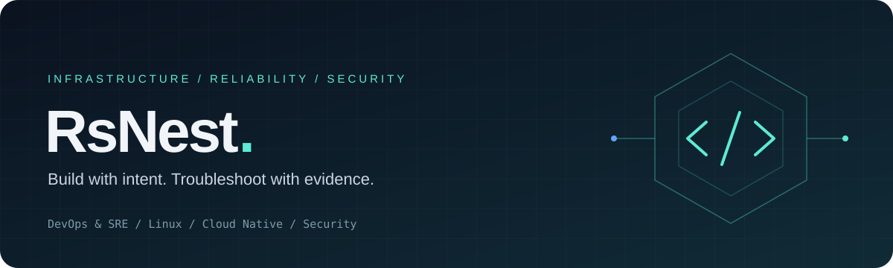

 

**Reliable platforms · Secure infrastructure · Practical automation**

 

## About me

I'm a **DevOps / SRE engineer working across infrastructure and security**. I build and operate microservice platforms, automate delivery, and troubleshoot complex issues across Linux, Kubernetes, networking and distributed services.

My approach is to follow the evidence: connect symptoms across metrics, logs and traces, isolate the failure, restore service, and address the root cause. I care about changes that make systems easier to operate, understand and secure.

A background in **telecom and VoIP** helps me work through network-heavy integrations, protocol issues and the less obvious boundaries between applications and infrastructure.

 

## What I work on

<table>
<tr>
<td width="50%" valign="top">

### Platform &amp; reliability

Kubernetes and container platforms, GitOps, Infrastructure as Code, reproducible environments and predictable delivery.

Troubleshooting service failures, rollout issues, resource bottlenecks and dependencies across production and pre-production.

</td>
<td width="50%" valign="top">

### Security &amp; access

Infrastructure security, secrets management, identity and access, SSO, TLS and secure service communication.

Troubleshooting authentication, authorization, certificate and connectivity issues; applying least privilege and keeping sensitive configuration out of application code.

</td>
</tr>
<tr>
<td width="50%" valign="top">

### Observability &amp; incidents

Metrics, logs, dashboards and actionable alerts that help explain system behavior.

Incident triage, root cause analysis and follow-up improvements to reduce recurring failures and make recovery more predictable.

</td>
<td width="50%" valign="top">

### Networking &amp; integrations

Service discovery, DNS, routing, reverse proxies and connectivity between services.

Tracing problems across TCP/IP, HTTP, TLS, gRPC and SIP, including integrations where networking and identity meet.

</td>
</tr>
</table>

 

## Stack &amp; toolkit

 

| Area | Technologies &amp; practices |
| :--- | :--- |
| **Systems &amp; automation** | Linux · Bash · Python · Go · Ansible · systemd |
| **Containers &amp; platforms** | Docker · Kubernetes · Helm · Nomad |
| **Delivery &amp; IaC** | Git · GitLab CI/CD · Argo CD · GitOps · Terraform |
| **Security &amp; identity** | Vault · OpenBao · Keycloak · SSO · RBAC · secrets management · TLS |
| **Networking** | TCP/IP · DNS · HTTP(S) · gRPC · SIP · Nginx · reverse proxying |
| **Data &amp; messaging** | PostgreSQL · Patroni · Redis · RabbitMQ · MinIO |
| **Observability &amp; operations** | Prometheus · Grafana · metrics &amp; log analysis · alerting · incident response · root cause analysis |

 

## Projects &amp; open source

| Project | Focus | Technologies |
| :--- | :--- | :--- |
| **ZeroRoute** | Android VPN application | Jetpack Compose · VLESS · REALITY |
| **Proxy Cascade** | Proxy routing and tunnel infrastructure | Xray-core · Nginx · network tuning |
| **TG TLS Patch** | Transport behavior and TLS research | TLS · client fingerprinting |
| **Go OSINT** | Research tooling and CLI development | Go · Cobra |

**Open source contribution:** [MHSanaei/3x-ui](https://github.com/MHSanaei/3x-ui) — included in [v2.9.3](https://github.com/MHSanaei/3x-ui/releases/tag/v2.9.3).

 

## Engineering mindset

- **Understand the failure.** Test hypotheses and trace dependencies before choosing a fix.
- **Make changes repeatable.** Keep infrastructure and delivery workflows versioned and reviewable.
- **Treat security as part of operations.** Consider access, secrets and trust boundaries alongside availability.
- **Leave the system better.** Turn incident findings into clearer alerts, useful documentation and durable fixes.

 

---

**Let's talk infrastructure, troubleshooting or security.**

[Message me on Telegram ↗](https://t.me/nadzerateli)

Build systems you can explain. Operate systems you can trust.

